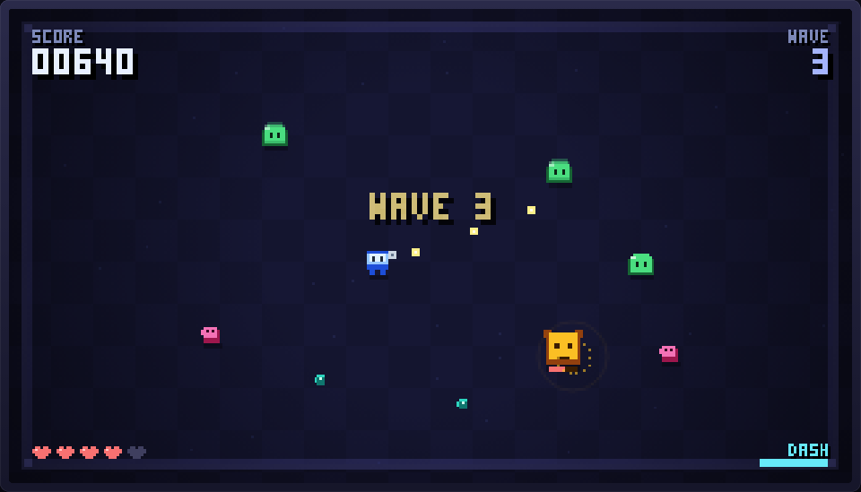

# Pixel Dash

A tiny top-down pixel-art arena game. Survive waves of slimes, runners, and brutes, collect the gems they drop, and beat your best score.

No build step, no dependencies, no asset files — the sprites, the bitmap font, and the sound effects are all generated in code.



## Play

Open `index.html` in any modern browser:

```bash
# just open the file
open index.html          # macOS
xdg-open index.html      # Linux
start index.html         # Windows

# or serve it, if you prefer
python3 -m http.server 8000
# then visit http://localhost:8000
```

## Controls

| Key | Action |
| --- | --- |
| `WASD` / arrow keys | Move |
| `Space` | Shoot |
| Mouse | Aim (hold click to shoot) |
| `Shift` | Dash (brief invulnerability) |
| `P` | Pause |
| `M` | Mute |
| `R` | Restart after game over |

## How it plays

- Enemies spawn from the edges and chase you. Each wave adds more of them, and they get faster.
- **Slime** — 1 HP, slow. **Runner** — 2 HP, fast and twitchy. **Brute** — 5 HP, big, hits hard, drops three gems.
- Defeated enemies sometimes drop gems. Gems are pulled toward you when you get close, and each one adds to your score.
- Clearing a wave pays a bonus of `25 × wave`. Every third wave restores a heart, up to five.
- You start with 3 hearts. Getting hit costs one and gives you a short window of invulnerability.
- Your best score is saved in `localStorage`.

## Project layout

| File | Purpose |
| --- | --- |
| `index.html` | Page shell, canvas, and the control hint |
| `style.css` | Page chrome, pixel-perfect canvas scaling |
| `game.js` | The whole game: input, simulation, rendering, sound |

The game renders to a 320×180 canvas and is scaled up with `image-rendering: pixelated`, so it stays crisp and pixelated at any window size.
